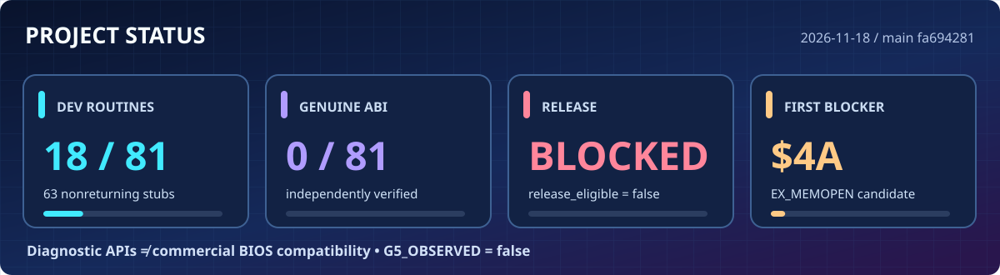
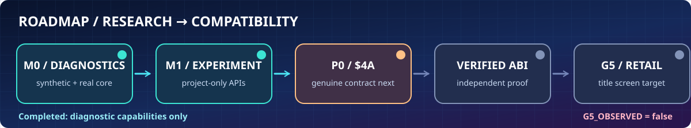

<div align="right">

**English** | [日本語](readme.jp.md)

</div>


<div align="center">

# oss-pce-cd-bios

**Open-source System Card BIOS research for PC Engine / TurboGrafx-CD**

*Building original firmware, reproducible diagnostics, and evidence toward future System Card 3.0 compatibility.*

[](https://github.com/mao2009/oss-pce-cd-bios/actions/workflows/ci.yml)
[](https://github.com/mao2009/oss-pce-cd-bios/actions/workflows/core-harness.yml)
[](https://github.com/mao2009/oss-pce-cd-bios/actions/workflows/api-source.yml)
[](LICENSE)


**[At a glance](#at-a-glance) · [Commercial observations](#commercial-cd-observations) · [Quick start](#quick-start) · [Documentation](docs/README.md) · [Roadmap](#roadmap)**

</div>

> [!IMPORTANT]
> **This is not a usable replacement System Card BIOS.** The repository provides development-only diagnostic firmware, experimental services, and synthetic or explicitly authorized local commercial-CD observations. No retail title screen, independently verified reference ABI, or releasable compatible firmware has been demonstrated.

## At a glance



| What works today | What is not established |
| :-- | :-- |
| Reproducible DEV ROM and pinned Geargrafx diagnostics | A distributable, compatible System Card BIOS |
| **18 of 81** project-defined DEV routines; **63** nonreturning stubs | Reference-BIOS ABI verification: **0 of 81** |
| PUBLIC IPL and experimental CD-service integration on synthetic media | Retail title-screen success (**G5_OBSERVED=false**) |
| Read-only commercial-CD tracing to the first blocking API | Approval of experimental routines as genuine BIOS services |

<sub>Figures and diagrams are a dated **2026-11-18** snapshot tied to experimental commit `fa694281`; they are not live compatibility statistics. CI workflow badges reflect current GitHub Actions status. Historical reference: `f90c16b` (2026-10-22).</sub>

Current DEV implementation count: **18/81**; current stubs: **63/81**; owner-approved **DEV_CALLABLE: 0**; reference **ABI VERIFIED: 0/81**; reference **JSR permitted: 0/81**. These are distinct metrics; see [implementation status](docs/status.md).

## Commercial CD observations


- **CUE[0]**: PUBLIC IPL → `$02` → `$33` → `$4A` **halt**
- **CUE[1]**: PUBLIC IPL → `$1E` → `$4A` **halt**

Both local, anonymized observations reached INFO/BODY loading and IPLJMP, with matching cold/warm results. **The first common blocker is the unimplemented `$4A` slot** (candidate names KEY_BIOS / EX_MEMOPEN). Commercial FIRST-mode `$03` was **not called** in either observed prefix. **This is not a successful game boot.**

[Sanitized evidence and limits](docs/g5-commercial-reobservation-2026-11-18.md) · [Issue #802](https://github.com/mao2009/oss-pce-cd-bios/issues/802) · [API Issue #84](https://github.com/mao2009/oss-pce-cd-bios/issues/84)

## Architecture


The experimental builder observes **PUBLIC IPL → RAM loading → project-defined service calls**. The ordinary **DEV ROM**, experimental **G5 BIOS image**, and intended future **compatible BIOS** are distinct targets; success in one is not an ABI certification for another.

[Architecture](docs/architecture.md) · [DEV vs experimental vs compatible](docs/project-guide.md) · [Candidate API inventory](docs/api-inventory.md)

## Quick start

For Linux / WSL development. **Do not use the output as a retail System Card replacement.**

```sh
make setup          # Prepare pinned tools
make dev-rom        # Build 256 KiB development diagnostic ROM
make test           # Host tests
make test-real-core # Pinned Geargrafx core diagnostics
make check          # Source, structure, and safety checks
```

See [Building](docs/building.md), [Testing](docs/testing.md), and [Geargrafx](docs/emulator-geargrafx.md). Commercial discs require explicit local opt-in, read-only handling, and sanitized evidence; they are not part of public CI.

## Roadmap



**Current P0:** Establish a provenance-approved calling contract for `$4A`, implement only evidence-supported behavior, validate with synthetic real-core tests, then re-observe the commercial execution paths. A simulated RTS is **never** proof of a correct BIOS service.

[Roadmap](docs/roadmap.md) · [Project review and priorities](docs/project-review-2026-11-18.md)

## Explore the docs

| Looking for… | Go to |
| :-- | :-- |
| **Project overview and terminology** | [Project guide](docs/project-guide.md) |
| **Setup, architecture, and tests** | [Building](docs/building.md) · [Architecture](docs/architecture.md) |
| **API status and ABI contracts** | [Status](docs/status.md) · [81-slot API inventory](docs/api-inventory.md) |
| **Commercial CD / G5 evidence** | [2026-11-18 observations](docs/g5-commercial-reobservation-2026-11-18.md) · [Evidence history](docs/g5-evidence-2026-11-18.md) |
| **Compatibility and provenance** | [Compatibility](docs/compatibility.md) · [Provenance](docs/provenance.md) |
| **All technical documents** | **[Documentation index](docs/README.md)** |

---

Original project code and documentation are [MIT-licensed](LICENSE); third-party contributions retain their respective license terms. This project is not affiliated with NEC, Hudson Soft, Konami, or other trademark holders.

[Japanese translation](readme.jp.md) · English README is the canonical project introduction.
