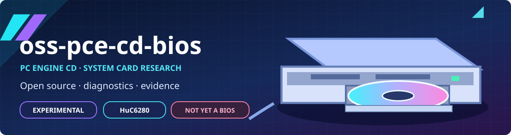
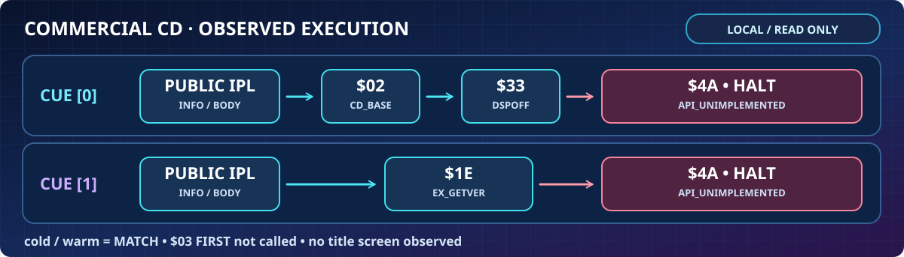
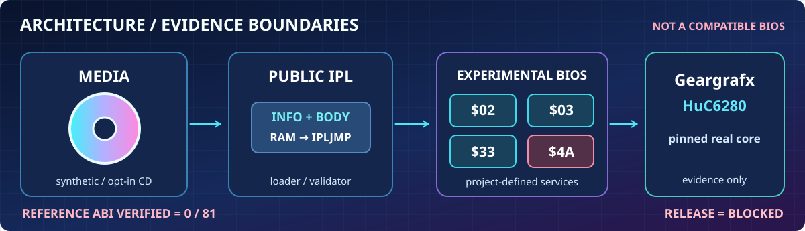

<div align="center">

# oss-pce-cd-bios

**PC Engine / TurboGrafx-CD 向けオープンソース System Card 互換BIOSを目指す研究・開発プロジェクト**

*Researching a clean-room, open-source System Card BIOS replacement. Not compatible firmware yet.*

[](https://github.com/mao2009/oss-pce-cd-bios/actions/workflows/ci.yml)
[](https://github.com/mao2009/oss-pce-cd-bios/actions/workflows/core-harness.yml)
[](https://github.com/mao2009/oss-pce-cd-bios/actions/workflows/api-source.yml)
[](LICENSE)


**[現在地](#現在地-at-a-glance) · [実測結果](#商用cdの観測) · [使い方](#試してみる) · [ドキュメント](docs/README.md) · [ロードマップ](#ロードマップ)**

</div>

> [!IMPORTANT]
> **これは市販CDを動かせる完成済み互換BIOSではありません。** 開発用診断ROM・実験用API・合成媒体および許可されたローカル商用媒体の観測結果を公開しています。ゲームのタイトル画面到達、真正System Card ABI互換、リリース適格性は**未達**です。

## 現在地 / At a glance


| できていること | まだできないこと |
| :-- | :-- |
| 再現可能なDEV ROMと固定版Geargrafxの検証 | 互換System Card BIOSとしての配布 |
| 開発用ルーチン **18 / 81**、残り **63スタブ** | 正式ABI検証 **0 / 81** |
| 合成CDでのPUBLIC IPLと実験的CDサービスの結合検証 | 市販タイトル画面到達（**G5_OBSERVED=false**） |
| 商用CDの最初の停止APIの特定（読取り専用） | 実験コードを真正APIと認定すること |

<sub>数値・図は **2026-11-18 / main `fa694281`** のスナップショット。CIバッジだけはGitHub Actionsの現在の結果です。詳細な集計定義は [status](docs/status.md) を参照。</sub>

## 商用CDの観測



- **CUE[0]**: PUBLIC IPL → `$02` → `$33` → `$4A` **停止**
- **CUE[1]**: PUBLIC IPL → `$1E` → `$4A` **停止**

どちらもINFO/BODY読込みとIPLJMPに到達し、cold/warmで結果が一致。**共通ブロッカーは未実装の `$4A`（KEY_BIOS / EX_MEMOPEN候補）**です。 `$03` commercial FIRSTは今回の商用prefixでは呼び出されていません。**起動成功ではありません。**

[実測の詳細と制限](docs/g5-commercial-reobservation-2026-11-18.md) · [Issue #802](https://github.com/mao2009/oss-pce-cd-bios/issues/802) · [API #84](https://github.com/mao2009/oss-pce-cd-bios/issues/84)

## しくみ / Architecture



実験用ビルダーは **PUBLIC IPL → RAMへのロード → 実験API呼出し** を観測します。通常DEV ROM、実験用BIOS、将来の互換BIOSは**別のもの**です。

[設計](docs/architecture.md) · [DEVと実験用ROMの違い](docs/project-guide.md) · [API台帳](docs/api-inventory.md)

## 試してみる

Linux / WSL向け。診断用ROMは**市販System Cardの代わりに使えません**。

```bash
make setup          # 固定版ツールチェーンの準備
make dev-rom        # 開発用256KiB診断ROM
make test           # ホストテスト
make test-real-core # Geargrafx実コア診断
make check          # 安全・構造チェック
```

詳しい環境・実験手順は [Building](docs/building.md)、[Testing](docs/testing.md)、[Geargrafx](docs/emulator-geargrafx.md) へ。商用媒体は**明示的opt-inかつローカル読取り専用**、公開CIには含まれません。

## ロードマップ


**次のP0:** `$4A`の呼出し契約を裏付け、実際の機能を独立実装・検証して商用経路を再観測する。仮RTS通過を互換性の証明にしません。

[Roadmap](docs/roadmap.md) · [現在の評価・改善課題](docs/project-review-2026-11-18.md)

## ドキュメント / Explore

| 見たいこと | 入口 |
| :-- | :-- |
| **初めて読む / できること** | [プロジェクトガイド](docs/project-guide.md) |
| **構成・ビルド・テスト** | [セットアップ](docs/building.md) · [アーキテクチャ](docs/architecture.md) |
| **APIの実装状況・ABI** | [現状](docs/status.md) · [81スロット台帳](docs/api-inventory.md) |
| **商用CD・G5検証証拠** | [11/18再観測](docs/g5-commercial-reobservation-2026-11-18.md) · [G5履歴](docs/g5-evidence-2026-11-18.md) |
| **互換性・安全性・ライセンス** | [互換性の判定基準](docs/compatibility.md) · [来歴](docs/provenance.md) |
| **すべての資料** | **[ドキュメント索引](docs/README.md)** |

---

オリジナルのコード・文書は [MIT](LICENSE)。他者のソフトウェア・媒体・商標は各権利者に帰属します。NEC / Hudson Soft / Konami等の公式プロジェクトではありません。
